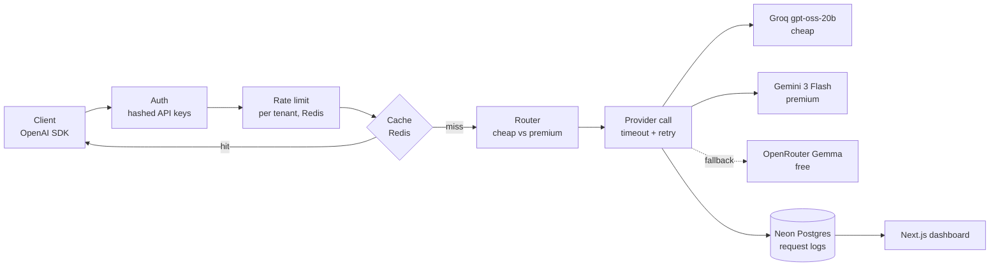

# LLM Gateway: cost-aware model routing

One OpenAI-compatible API in front of multiple LLM providers. Each request goes to the
**cheapest model that can handle it**, with caching, rate limiting, retries,
cross-provider fallback, and per-request cost and latency tracking.

**Live dashboard:** https://llm-gateway-jade-psi.vercel.app
**Live API:** https://llm-gateway-c2ba.onrender.com (free tier, so the first request may take ~30–60 s to wake up)


## Results

Eval: 19 tasks (15 simple / 4 hard), cache off, fallback off.

| Arm | Accuracy | Total cost | Cost per correct answer | p50 latency |
|---|---|---|---|---|
| all-cheap (Groq gpt-oss-20b) | 100% | $0.000313 | $0.0000165 | 851 ms |
| **routed** | **100%** | **$0.006707** | **$0.000353** | **922 ms** |
| all-premium (Gemini 3 Flash) | 100% | $0.012185 | $0.000641 | 1,648 ms |

- Routing cut **cost per correct answer by 45%** and **median latency by 44%** vs all-premium, with **no accuracy loss**.
- Only **16%** of requests went to the premium model.
- **Honest caveat:** the cheap tier also scored 100% on this set, so the router is conservative here. The next step is a harder eval to find where the cheap model fails, then tune the rules.

Routed results are computed **offline**: the router is deterministic, so applying its rules to the real
cheap and premium answers gives the same result as live routing, with half the API calls (the premium
free tier allows only 20 requests/day). Costs are **shadow costs**: token counts × each provider's
published paid price. All usage ran on free tiers.

Production cache hits (Render → Upstash, same region): **~65–85 ms** vs **2–5 s** for a premium call.

## Architecture



## Features
- **OpenAI-compatible API:** any OpenAI SDK works by changing `baseURL`
- **Rule-based router:** task type, priority, input length and code detection pick the tier; every decision logs its reason
- **Cascade:** cut-off or empty cheap answers escalate to premium once (both costs counted)
- **Reliability:** per-model timeouts, one retry with exponential backoff + jitter for transient errors, cross-provider fallback chains, `x-fallback: off` for clients that prefer an error over a substitute, fault-injection header for testing (disabled in production)
- **Multi-tenant security:** SHA-256-hashed API keys, per-tenant sliding-window rate limits (Upstash Redis), fail-open if Redis is down
- **Cache:** per-tenant exact-match response cache with 1-hour TTL; fallback and cut-off answers are never cached
- **Observability:** every request logged to Postgres (metadata only, never prompts), exact `NUMERIC` costs, and a dashboard for savings, p50/p95, cache hit rate, fallback rate and per-tier/per-tenant breakdowns

## Using the API

```ts
import OpenAI from "openai";

const gateway = new OpenAI({
  apiKey: process.env.GATEWAY_KEY, // gateway keys are private; demo access on request
  baseURL: "https://llm-gateway-c2ba.onrender.com/v1",
});

const res = await gateway.chat.completions.create(
  { model: "auto", messages: [{ role: "user", content: "What is Redis?" }] },
  { headers: { "x-task-type": "chat", "x-priority": "normal" } }
);
// res.gateway → { tier, route_reason, cache, cost_usd, latency_ms, ... }
```

## Design decisions
- **Rules instead of an LLM router:** free, instant and explainable; an LLM router adds cost and latency to every request
- **Retry vs fallback:** 5xx and dropped connections retry once; 429s and timeouts switch provider immediately
- **Cost per correct answer** as the main metric, because a cheap wrong answer isn't a saving
- **Respond first, then cache and log**, so bookkeeping never adds user latency
- **Stateless gateway:** all state lives in Redis and Postgres, so it can scale horizontally

## Limitations
- Small eval set (19 tasks); results vary between runs
- Exact-match cache only (semantic cache is future work)
- Free-tier providers: models rotate, and the premium tier allows only 20 requests/day
- Public dashboard shows demo metadata only; a real deployment needs auth and per-tenant views

## Run locally

```bash
npm install
cp .env.example .env          # fill in your keys
npm run db:migrate
npm run dev                   # gateway on :3000
npm run eval                  # reproduce the results table

cd dashboard && npm install
npm run dev -- -p 3001        # dashboard on :3001 (needs DATABASE_URL in dashboard/.env.local)
```

## Tech stack
Node.js · TypeScript · Express · Zod · OpenAI SDK · Upstash Redis · Neon Postgres · Next.js · Tailwind CSS · Render · Vercel